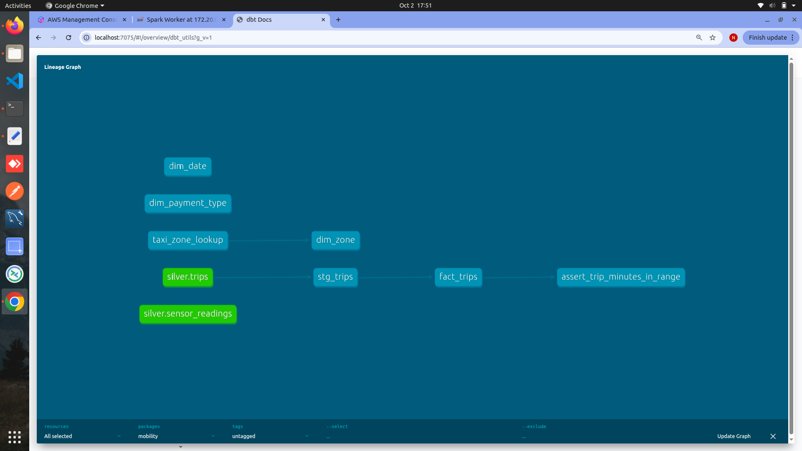

# Smart Mobility Data Platform

An end-to-end data platform that combines a **monthly batch pipeline** (NYC TLC yellow-taxi trips) and a **real-time streaming pipeline** (simulated city sensors: traffic, CO, temperature, visibility) into one AWS lakehouse. The lakehouse uses a Bronze → Silver → Gold medallion layout, dbt star-schema marts, Airflow orchestration and Streamlit dashboards on Athena.

**Stack:** Python 3.11 · Apache Kafka 3.8 (KRaft) · Spark Structured Streaming 3.5 · AWS S3 · AWS Glue 4.0 (PySpark) · Amazon Athena · dbt-athena · Apache Airflow 2.10 · Streamlit · scikit-learn · GitHub Actions

---

## Architecture

```
                 BATCH (monthly)                                  STREAMING (continuous)
  ┌─────────────────────────────┐                     ┌──────────────────────────────────┐
  │ NYC TLC yellow-taxi Parquet │                     │ sensor_simulator.py (20 sensors) │
  │ (CloudFront public files)   │                     │ + malformed / duplicate / anomaly│
  └──────────────┬──────────────┘                     └────────────────┬─────────────────┘
                 │ Airflow: tlc_to_bronze                              │ Kafka topic: sensor-readings
                 │ (stream download → S3, fixed key)                   │ (key = sensor_id, acks=all)
                 ▼                                                     ▼
  ┌──────────────────────────────────────────────────────────────────────────────────────┐
  │ BRONZE  s3://<bucket>/bronze/                                                        │
  │   trips/year=YYYY/month=MM/                  sensors/date=…/hour=…/  (Parquet, 1 min)│
  │                                              dead_letter/date=…/     (raw JSON)      │
  └──────────────┬───────────────────────────────────────────────────┬───────────────────┘
                 │ Glue job: trips_bronze_to_silver                  │ Glue job: sensors_bronze_to_silver
                 │ rename/cast · validate · sha2 trip_id · dedup     │ dedup event_id · filter · compact
                 ▼                                                   ▼
  ┌──────────────────────────────────────────────────────────────────────────────────────┐
  │ SILVER  mobility_silver.trips (pickup_date)   mobility_silver.sensor_readings        │
  │         + dq_metrics/ (row counts per run)    (reading_date)                         │
  └──────────────┬───────────────────────────────────────────────────┬───────────────────┘
                 │ dbt (Athena)                                      │ dbt snapshot (SCD2) + models
                 ▼                                                   ▼
  ┌──────────────────────────────────────────────────────────────────────────────────────┐
  │ GOLD  mobility_gold                                                                  │
  │   fact_trips ── dim_date · dim_zone · dim_payment_type                               │
  │   fact_sensor_hourly ── dim_sensor (SCD Type 2, point-in-time join)                  │
  └──────────────┬───────────────────────────────────────────────────────────────────────┘
                 ▼
     Streamlit dashboards (taxi KPIs · sensor analysis · natural-language → SQL)
     IsolationForest anomaly detection on sensor aggregates
```

dbt lineage:



---

## What this project demonstrates

| Concern | How it is handled |
|---|---|
| **Idempotent re-runs** | Fixed S3 key for raw ingest; Spark `partitionOverwriteMode=dynamic`; dbt `incremental` + `insert_overwrite` scoped to `run_month` / `run_date`. Re-running a month or day rewrites only that partition. |
| **Deterministic keys** | `trip_id = sha2(vendor, pickup, dropoff, PU, DO, total_amount)`, so the same source row always gets the same ID and duplicates collapse. |
| **Bad data isolation** | Streaming records that fail schema/validation go to a **dead-letter** path with Kafka partition and offset, so nothing is silently dropped. |
| **Duplicate events** | The simulator deliberately re-sends events; Silver deduplicates on `event_id`. |
| **Small-files problem** | Streaming writes a file per minute per partition; the daily Glue job compacts each day into one partition. |
| **Slowly changing dimensions** | `dim_sensor` is built from a dbt **snapshot** (SCD Type 2). `fact_sensor_hourly` joins on `reading_hour BETWEEN valid_from AND valid_to`, so each reading is attributed to the sensor configuration that was active at the time. |
| **Data quality** | dbt tests (unique, not_null, relationships to every dimension, `accepted_range`, custom trip-duration test) plus per-run row-count metrics written to `s3://<bucket>/dq_metrics/`. |
| **Grain enforcement** | `dbt_utils.unique_combination_of_columns` on `(sensor_id, reading_hour)` guards the fact grain, and would catch overlapping SCD2 windows that fan out the point-in-time join. |
| **Testing & CI** | GitHub Actions runs `ruff`, compiles all Python, runs `dbt parse`, unit-tests the SQL guardrail, and runs the Glue transformation unit tests **inside the official AWS Glue 4.0 image**. |

---

## Data

### Batch: NYC TLC yellow-taxi trips
- Source: public monthly Parquet files from the NYC Taxi & Limousine Commission.
- Scope: January–December 2023 (Airflow backfill with `catchup=True`).
- Silver rules: `pickup_ts` inside the run month, `dropoff > pickup`, `0 < trip_distance < 200`, `total_amount >= 0`, `1 <= trip_minutes <= 300`.

### Streaming: simulated sensors
- 20 sensors (5 each of `traffic_count`, `co_ppm`, `temperature_c`, `visibility_m`) mapped to 5 NYC taxi zones.
- One reading per sensor every 2 s (~10 events/s).
- Realistic noise: random-walk values, rush-hour traffic baseline, 5–15 min **anomaly episodes**, single **spikes**, ~1% **malformed** and ~1% **duplicate** messages.
- Each event carries a `sim_label` (`normal` / `anomaly` / `spike`), used only to *evaluate* anomaly detection, never to train it.

---

## Gold data model

**Trips star schema**
- `fact_trips`: one row per valid trip, partitioned by `pickup_month`
- `dim_date`: calendar 2023-01-01 → 2026-12-31
- `dim_zone`: 265 TLC taxi zones (seed)
- `dim_payment_type`: TLC payment codes

**Sensor star schema**
- `fact_sensor_hourly`: one row per sensor per hour (count, avg, min, max, stddev), partitioned by `reading_date`
- `dim_sensor`: SCD Type 2 history of sensor type, zone and firmware version

---

## Orchestration (Airflow)

**`trips_monthly`** (`@monthly`, backfills 2023)
```
tlc_to_bronze → trips_bronze_to_silver → register_silver_partitions
  → dbt_seed → dbt_staging → dbt_snapshot → dbt_gold → dbt_test
```

**`sensors_daily`** (`@daily`, each run processes the previous complete day)
```
sensors_bronze_to_silver → register_silver_partitions
  → dbt_snapshot → dbt_run_sensor_models → dbt_test_sensor_models
```

Both DAGs use `max_active_runs=1` so incremental dbt runs never overlap, plus retries with a failure callback.

---

## Repository layout

```
streaming/          Kafka sensor simulator + Spark Structured Streaming → S3 Bronze
glue/scripts/       Bronze → Silver PySpark jobs (Glue 4.0)
airflow/            DAGs, custom Airflow image (Docker CLI + isolated dbt venv), compose file
dbt_mobility/       staging views, Gold marts, seeds, SCD2 snapshot, tests
dashboard/          Streamlit apps: taxi KPIs, sensor analysis, natural-language → SQL
ai/                 IsolationForest anomaly detection on sensor aggregates
tests/glue/         PySpark unit tests for the trip transformation
tests/dashboard/    unit tests for the LLM SQL guardrail
.github/workflows/  CI pipeline
```

---

## Running it locally

### Prerequisites
- Docker + Docker Compose, Python 3.11
- An AWS account with an S3 bucket, and Glue Data Catalog databases `mobility_silver` and `mobility_gold`
- AWS credentials with S3, Glue Catalog and Athena access

### 1. Configure
```bash
cp .env.example .env              # set S3_BUCKET, AWS_REGION, HOST_PROJECT_ROOT, ...
set -a && source .env && set +a   # export the variables to this shell
cp dbt_mobility/profiles.example.yml dbt_mobility/profiles.yml   # reads S3_BUCKET
python -m venv .venv && source .venv/bin/activate
pip install -r requirements.txt
```

### 2. Start Kafka and the stream
```bash
docker compose up -d kafka
python streaming/sensor_simulator.py                 # terminal 1
python streaming/spark_kafka_stream.py               # terminal 2 (Spark UI: localhost:4040)
```

### 3. Start Airflow
```bash
cd airflow
# Needs HOST_PROJECT_ROOT, S3_BUCKET, AIRFLOW_UID and DOCKER_GID from .env (exported above).
# HOST_PROJECT_ROOT is the repo path on the *host*: the Glue container is started
# through the host Docker socket, so it mounts host paths.
docker compose up -d --build                         # UI: http://localhost:8080 (airflow / airflow)
```
Unpause `trips_monthly` to backfill 2023, and `sensors_daily` for sensor data.

### 4. Dashboards
```bash
cd dashboard
streamlit run mobility/app.py        # taxi KPIs
streamlit run app_sensor.py          # sensor analysis + SCD2 history
streamlit run mobility/ai_app.py     # natural-language → SQL (needs OPENROUTER_API_KEY)
```

### 5. Anomaly detection
```bash
python ai/anomaly_detection.py
```

### Tests
```bash
ruff check .
pytest -q tests/dashboard                            # SQL guardrail
# Glue unit tests in the real Glue 4.0 runtime:
docker run --rm -v "$PWD":/home/hadoop/workspace -w /home/hadoop/workspace \
  --entrypoint python3 public.ecr.aws/glue/aws-glue-libs:glue_libs_4.0.0_image_01 \
  -m pytest -q tests/glue
```

---

## Design decisions

- **Medallion layers on S3 + Athena** instead of a warehouse: storage and compute are separate, cost is pay-per-query, and every layer can be queried for debugging.
- **Glue-compatible PySpark, run locally:** the Glue scripts run in the official `aws-glue-libs` 4.0 image, started by Airflow through the Docker socket. This keeps the code deployable as managed Glue jobs while avoiding DPU cost during development.
- **Transformations as pure functions** (`rename_and_cast_trips`, `filter_valid_trips`, `finalize_trips`) so they can be unit-tested without S3.
- **dbt in an isolated venv inside the Airflow image** to avoid dependency conflicts with Airflow providers.
- **One IsolationForest per sensor type**, because CO in ppm and visibility in metres live on different scales.
- **Guardrails for LLM-generated SQL:** generated SQL is parsed into an AST with `sqlglot` (Trino dialect, as used by Athena engine v3). Only a single read query is accepted, and every table reference, including those in comma joins, subqueries and CTEs, must be in an allow-list of Gold tables.

---

## Known limitations & next steps

Being explicit about what this is and isn't:

- **Scale:** ~10 events/s and one year of taxi data. Kafka + Spark are used to learn the streaming pattern, not because this volume requires them.
- **Not fully managed AWS yet:** Glue scripts run locally rather than as managed Glue jobs; Spark streaming runs in `local[*]` with local checkpoints.
- **Infrastructure is manual:** bucket, catalog databases, Silver tables and IAM are not yet in Terraform.
- **Partition registration** uses `MSCK REPAIR TABLE`; Athena partition projection would scale better.
- **Data-quality metrics are recorded but not enforced:** the next step is failing the DAG when the rejection rate crosses a threshold, and adding source freshness and grain-uniqueness tests.
- **NL→SQL relies on application-level validation:** production would add a read-only IAM role scoped to `mobility_gold` and an Athena workgroup (`ATHENA_WORKGROUP`) with a bytes-scanned limit.
- **The sensors Glue job** runs at module level and is not yet unit-tested like the trips job.
- **Trips and sensors are not yet joined:** a planned mart compares zone-level trip demand with traffic and air-quality readings.

---

## License

MIT © 2026 Nandini Maurya
